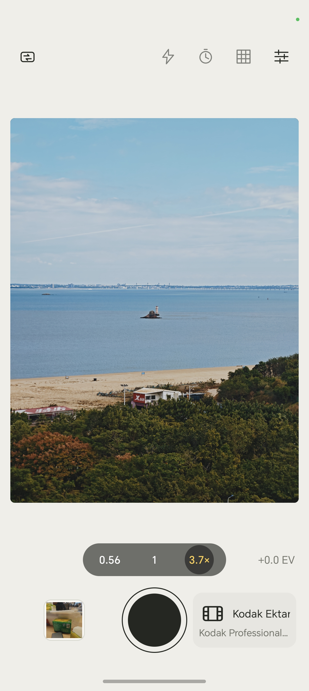
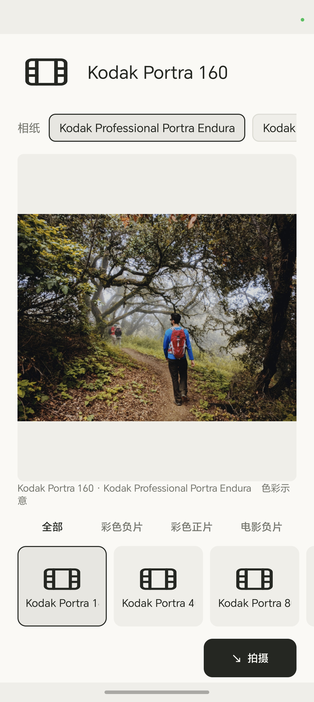
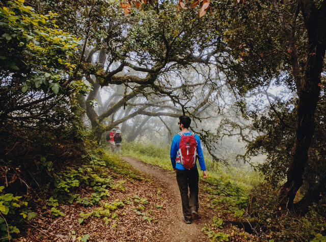
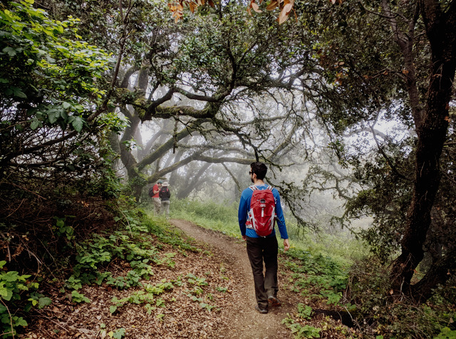
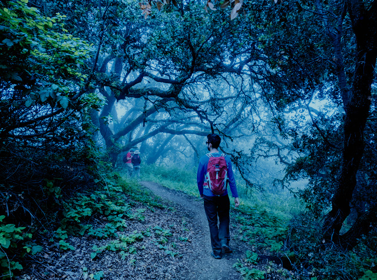

# SpektraCam

[简体中文](README.zh-CN.md) · **English**

SpektraCam is a film-simulation camera for **Android and iOS**. Choose a film stock and print medium, frame the shot with a live color preview, and take a single Bayer RAW exposure. SpektraFilm develops it on the device and saves a JPEG to the system photo library.

| Viewfinder | Film and paper selection |
| :---: | :---: |
|  |  |

| Kodak Portra 400 | Fujifilm Provia 100F | Kodak Vision3 500T |
| :---: | :---: | :---: |
|  |  |  |

The same scene rendered with three preview LUTs. The source photo is from the Google HDR+ Burst Photography Dataset, and the preview images are licensed under CC BY-SA 4.0. [Photo credit and license](docs/provenance.md#示意照片)

## What you can do

- **Choose film and paper.** Pick from 20 color negative, reversal, and motion-picture negative stocks. Color negatives offer six photo papers, motion-picture negatives offer Kodak 2383 or 2393 print film, and reversal film uses direct scanning.
- **Frame the shot.** See the selected look in the viewfinder, tap to focus on supported lenses, and use lens switching, pinch zoom, exposure compensation, a grid, and a timer.
- **Develop one RAW exposure.** Histogram-based middle-gray metering is the default for RAW development. The full SpektraFilm pipeline renders film grain, halation, and the selected print look.
- **Review your photos.** Tap the latest-shot thumbnail to open the in-app gallery, or press and hold to open the latest shot directly. Swipe between photos, pinch to zoom, and view the film and paper used for each shot. The viewer also supports sharing and deletion.
- **App language.** Follow the system language or choose English or Simplified Chinese in Settings. With the system option, Chinese system languages use Simplified Chinese and all others use English.

## Build from source

### Android

Install JDK 21, Python 3, Android SDK Platform 35, NDK `26.1.10909125`, and SDK CMake `3.22.1`. Set `ANDROID_HOME` to the SDK directory.

```sh
./gradlew :app:assembleDebug
adb install -r app/build/outputs/apk/debug/app-debug.apk
```

The APK targets `arm64-v8a` devices running Android 8.0 (API 26) or later. The camera must support Bayer `RAW_SENSOR` capture alongside an OpenGL ES 3 preview stream. RAW processing requires Vulkan. Available lenses depend on the device.

### iOS

On macOS, install Xcode, CMake, Python 3, and `glslc`. The build script looks for the Android NDK's `glslc` by default. Set `SPEKTRACAM_GLSLC` to use another installation. The script downloads and verifies the pinned MoltenVK release unless you point `MOLTENVK_ROOT` at an existing copy.

```sh
./scripts/build-ios.sh
```

The app bundle is written to `build/ios/Release-iphoneos/SpektraCam.app`. For a device build, set `IOS_DEVELOPMENT_TEAM` or configure signing in the generated Xcode project. The minimum version is iOS 15. The app only offers lenses that report Bayer RAW support.

To build for the iPhone Duo simulator on Apple silicon, use Xcode 27.1 or later and install an iOS simulator runtime that includes iPhone Duo support from Xcode Settings → Components.

```sh
./scripts/build-ios.sh --simulator
```

In Device Hub, boot an iPhone Duo simulator and install `build/ios-simulator/Release-iphonesimulator/SpektraCam.app`. Open the film and paper selector to capture its bundled photo preview. Use the Device Hub screenshot control with the device folded for the outer display (1398 × 2034 in portrait) and unfolded for the inner display (2007 × 2853 in portrait). Bayer RAW capture requires a physical device.

For an App Store JPEG, look up the active screen's ID with `xcrun simctl io <UDID> enumerate`. The capture script checks the pixel dimensions and saves the simulator's JPEG without an alpha channel.

```sh
./scripts/capture-ios-duo.sh "$udid" "$display_id" duo.jpg
```

To capture the viewfinder, launch the simulator build with `--sample-viewfinder`. The viewfinder labels the selected film's bundled image as a sample preview.

```sh
xcrun simctl launch --terminate-running-process "$udid" org.spektracam.app --sample-viewfinder
```

## Development

| Path | Contents |
| --- | --- |
| `app/` and `ios/` | Camera2 and AVFoundation capture, viewfinder, gallery, and settings |
| `core/` | Shared RAW reconstruction, lens shading correction, and film development interface |
| `assets/spektra/` | Film catalog, profiles, spectral data, preview LUTs, and sample photos |
| `third_party/spektrafilm_android/` | Pinned C++ engine, notices, and local patches |

<details>
<summary>Run tests</summary>

```sh
cmake -S . -B build/host -DCMAKE_BUILD_TYPE=Release
cmake --build build/host
ctest --test-dir build/host --output-on-failure
python3 tools/film_lut/verify_preview_luts.py
```

For the RAW development smoke test on a connected arm64 Android device:

```sh
./gradlew :app:assembleDebug :app:assembleDebugAndroidTest
adb install -r app/build/outputs/apk/debug/app-debug.apk
adb install -r -t app/build/outputs/apk/androidTest/debug/app-debug-androidTest.apk
adb shell am instrument -w org.spektracam.test/org.spektracam.FilmSmokeInstrumentation
```

See the [device validation notes](docs/validation.md) for manual checks.

</details>

## Support and community

To support SpektraCam, scan this QR code in Alipay.


## Credits and license

SpektraCam extracts LutCam's single-frame RAW pipeline, film adapter, and Android viewfinder. It carries over the same patched C++ film engine that LutCam already used. [Source provenance](docs/provenance.md)

Upstream credits: [Spektrafilm for Android by Akshay Sharma](https://github.com/thetechgeekko/Spektrafilm-android) · [Film modeling powered by spektrafilm by Andrea Volpato](https://github.com/andreavolpato/spektrafilm)

See [GPLv3](LICENSE) for the project license text. Third-party code, film profiles, LUTs, and sample photos have their own notices and license terms. [Provenance and licensing](docs/provenance.md)
