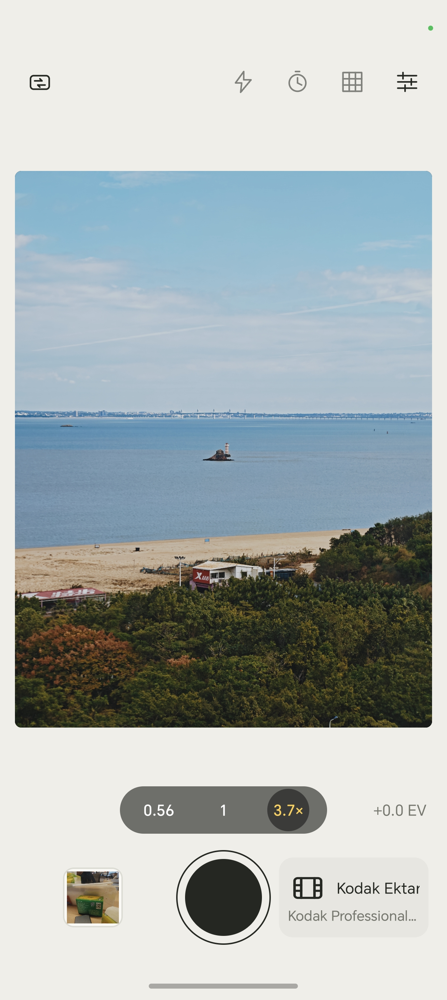
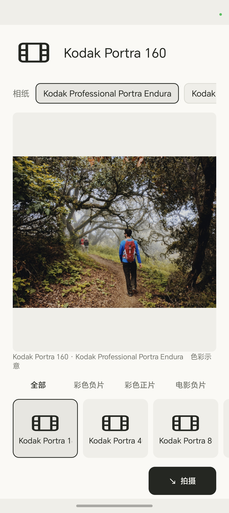
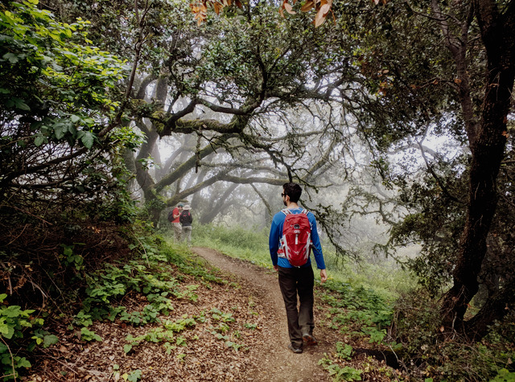
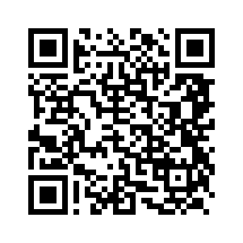

# SpektraCam

**简体中文** · [English](README.md)

SpektraCam 是一款面向 **Android 和 iOS** 的胶片模拟相机。选好胶卷和相纸后，可以在取景器中实时查看色彩。按下快门拍摄一张 Bayer RAW，由 SpektraFilm 在设备上显影，最终把 JPEG 存入系统相册。

| 取景器 | 胶片和相纸选择 |
| :---: | :---: |
|  |  |

| Kodak Portra 400 | Fujifilm Provia 100F | Kodak Vision3 500T |
| :---: | :---: | :---: |
|  |  |  |

同一场景应用三款胶片的预览 LUT。原照来自 Google HDR+ Burst Photography Dataset，示意图按 CC BY-SA 4.0 提供。[照片署名与许可](docs/provenance.md#示意照片)

## 主要功能

- **选择胶卷和相纸。** 提供 20 款彩色负片、正片和电影负片。彩色负片可搭配 6 款相纸，电影负片可搭配 Kodak 2383 或 2393 印片，正片直接扫描。
- **实时取景。** 在取景器中看所选胶片的色彩，支持点按对焦、切换镜头、双指变焦、曝光补偿、网格线和定时拍摄。对焦与可用镜头取决于设备。
- **单张 RAW 显影。** 默认使用直方图中灰测光。成片经过完整的 SpektraFilm 显影流程，呈现胶片颗粒、光晕和所选相纸的色彩。
- **内置相册。** 轻点拍摄页缩略图进入相册，长按直接打开最近一张。大图可左右翻看、双指缩放，工具栏可以查看使用的胶卷和相纸，也可以分享或删除照片。
- **界面语言。** 在设置里选择跟随系统、简体中文或 English。跟随系统时，中文系统使用简体中文，其他系统语言使用英文。

## 从源码构建

### Android

安装 JDK 21、Python 3、Android SDK Platform 35、NDK `26.1.10909125` 和 SDK CMake `3.22.1`。将 `ANDROID_HOME` 设为 Android SDK 目录。

```sh
./gradlew :app:assembleDebug
adb install -r app/build/outputs/apk/debug/app-debug.apk
```

APK 适用于 Android 8.0（API 26）及以上的 `arm64-v8a` 设备。相机需能同时输出 Bayer `RAW_SENSOR` 和 OpenGL ES 3 取景流，RAW 处理需要 Vulkan。可用镜头随设备而异。

### iOS

在 macOS 上安装 Xcode、CMake、Python 3 和 `glslc`。脚本默认查找 Android NDK 自带的 `glslc`，也可用 `SPEKTRACAM_GLSLC` 指定路径。脚本会下载并校验固定版本的 MoltenVK，已有副本可通过 `MOLTENVK_ROOT` 指定。

```sh
./scripts/build-ios.sh
```

产物位于 `build/ios/Release-iphoneos/SpektraCam.app`。真机安装需要签名，可设置 `IOS_DEVELOPMENT_TEAM`，或在生成的 Xcode 工程中配置签名。最低系统版本为 iOS 15，应用只提供支持 Bayer RAW 的镜头。

## 项目结构

| 路径 | 内容 |
| --- | --- |
| `app/` 和 `ios/` | Camera2 与 AVFoundation 采集、取景器、相册和设置 |
| `core/` | 两端共用的 RAW 重建、镜头阴影校正和胶片显影接口 |
| `assets/spektra/` | 胶片目录、配置、光谱数据、预览 LUT 和示意照片 |
| `third_party/spektrafilm_android/` | 固定版本的 C++ 引擎、署名和本地补丁 |

<details>
<summary>运行测试</summary>

```sh
cmake -S . -B build/host -DCMAKE_BUILD_TYPE=Release
cmake --build build/host
ctest --test-dir build/host --output-on-failure
python3 tools/film_lut/verify_preview_luts.py
```

在连接的 arm64 Android 真机上运行 RAW 显影测试：

```sh
./gradlew :app:assembleDebug :app:assembleDebugAndroidTest
adb install -r app/build/outputs/apk/debug/app-debug.apk
adb install -r -t app/build/outputs/apk/androidTest/debug/app-debug-androidTest.apk
adb shell am instrument -w org.spektracam.test/org.spektracam.FilmSmokeInstrumentation
```

实拍验收步骤见[真机验证记录](docs/validation.md)。

</details>

## 捐款与交流

如果你愿意支持 SpektraCam，可以用支付宝扫描下方收款码。



## 署名与许可

SpektraCam 的单帧 RAW 管线、胶片适配层和 Android 取景器从 LutCam 提取，并沿用 LutCam 已集成的同一套带补丁的 C++ 胶片引擎。[源码来源](docs/provenance.md)

上游署名：[Akshay Sharma 的 Spektrafilm for Android](https://github.com/thetechgeekko/Spektrafilm-android) · [胶片模型由 Andrea Volpato 的 spektrafilm 提供](https://github.com/andreavolpato/spektrafilm)

项目许可正文见 [GPLv3](LICENSE)。第三方代码、胶片配置、LUT 和示意照片各有对应的署名和许可条款。[来源与许可说明](docs/provenance.md)
